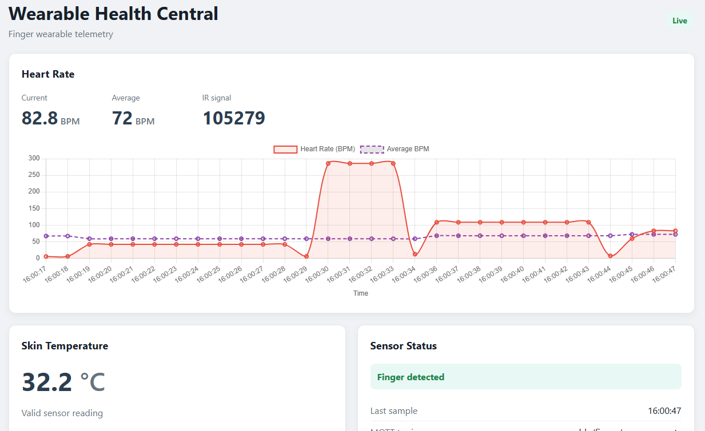

# PCS 3858: Embedded Systems Laboratory

This repository contains the group project for the course [**PCS 3858: Embedded Systems Laboratory**](https://uspdigital.usp.br/jupiterweb/obterDisciplina?sgldis=PCS3858&verdis=1) at the University of São Paulo.

Open electronics project for a biometric monitoring system with an [ESP32](https://en.wikipedia.org/wiki/ESP32) based modular wearable sensor module and a [Raspberry Pi 3B+](https://www.raspberrypi.com/products/raspberry-pi-3-model-b-plus/) based central monitoring dashboard. Wireless communication of the sensor data collected at the ESP32 based sensor node is transmitted via [MQTT](https://mqtt.org/) to a [Mosquitto broker](https://mosquitto.org/) hosted at the Raspberry Pi.

**A video demonstration for the project's initial prototype presentation is [available on Youtube](https://youtu.be/4NxQbYR5aoM).**



## Table of contents
- [System overview](#system-overview)
- [Repository file structure](#repository-file-structure)
- [Reference Links](#reference-links)


## System overview

There are 2 nodes in the system:

1. ESP32 wearable device with ***(a)*** a component to be placed on the user's finger with **MAX30102 pulse oximeter and heart rate sensor** and **NTC20K thermistors** for the *biometric data collection feature*; and ***(b)*** a component to be placed on the user's body with **MPU6050 accelerometer** collecting data for the *fall detection feature*. A **LED button** and a **vibration motor** are integrated for a *false positive prevention feature*, where incorrect fall detections can be flagged to avoid triggering an alert on the server.

2. Raspberry Pi 3B+ server running an **MQTT broker** to collect published sensor data from the ESP32 nodes and a **Flask dashboard web application** using the integrated [Jinja template engine](https://flask.palletsprojects.com/en/stable/templating/).

**OBS**: the **MAX30102** and **MPU6050** sensors share a connection to the I2C pins in the ESP32. The thermistor measurements are provided via an AnalogInput pin.

## Repository file structure

```
PCS3858-EmbeddedSystemsLab
├── wearable_esp32
├──── wearable_esp32.ino
├── server
├──── main.py
├──── WebApp.py
├──── MqttManager.py
├──── templates/
│   └──── index.html
└──── static/
    ├──── js/
    │   └──── dashboard.js
    └──── css/
        └──── style.css
```

## Reference Links

- [ESP32-C3-MINI-1 datasheet](https://documentation.espressif.com/esp32-c3-mini-1_datasheet_en.pdf)
- [Vibration Motor datasheet](https://dynamic.me/index.php?route=product/product/download&pdf=244&document_id=2258)
- [MPU-6050 Adafruit library](https://thinkrobotics.com/blogs/tutorials/mpu6050-tutorial-complete-guide-to-arduino-motion-sensing-for-robotics?srsltid=AU7gw4VchZZtGeOV7VDctssY_GERE_-E5XZ9nzlNcVwggXjlix6Jmn8V)
- [SparkFun MAX301x Particle Sensor Library](https://github.com/sparkfun/sparkfun_max3010x_sensor_library)
- [NTC 20K Thermistor celsius temperature characteristic](https://prod-edam.honeywell.com/content/dam/honeywell-edam/hbt/en-us/documents/literature-and-specs/datasheets/centraline/hbt-bms-en0b0476-ge51r0319.pdf?download=false)
